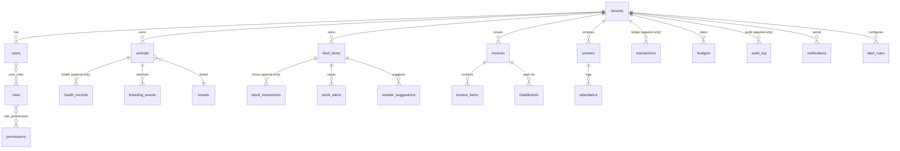

# Entity Relationship Diagram

## Notes

- `animals.dam_id` / `animals.sire_id` are self-references (mother / father) enabling lineage.
- `origin` distinguishes `purchased` vs `local` vs `newborn` (breeding module requirement).
- Attendance is manager-entered (`recorded_by`) and worker-acknowledged (`acknowledged_by`).
- Audit and health history are restricted to owner/manager roles via RBAC (see migration 0002).
